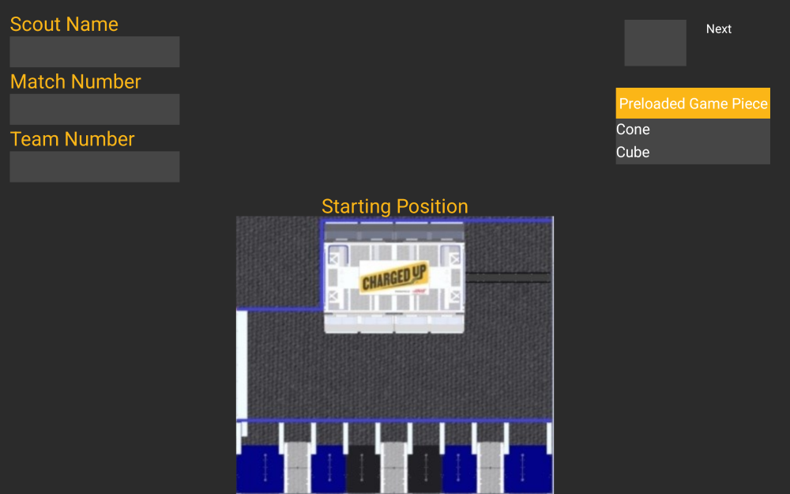
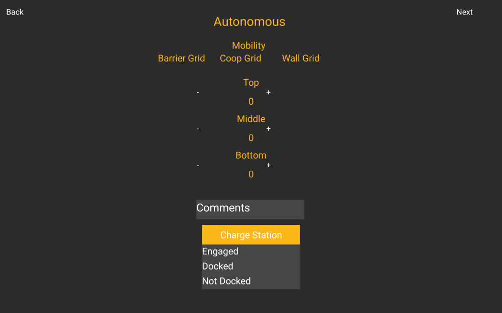
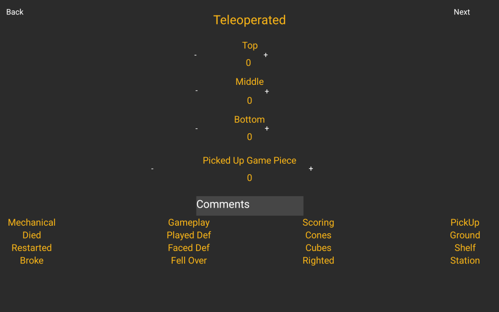
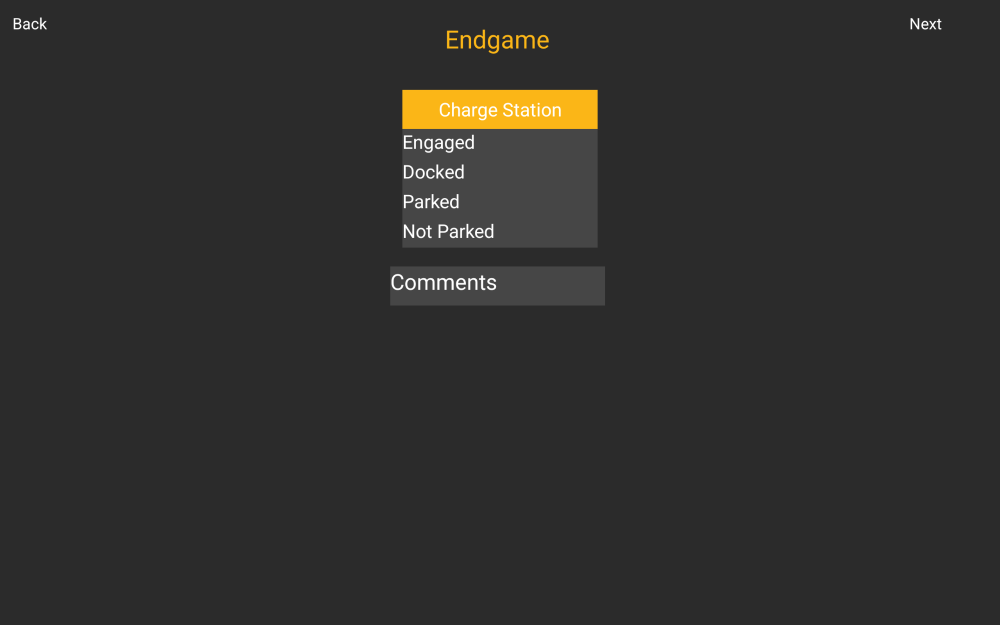
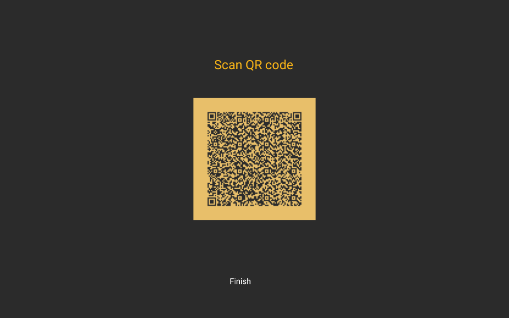
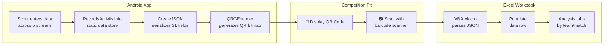

# FRC 2023 Charged Up Match Scouting App

<div align="center">

[](https://developer.android.com/studio)
[](https://docs.oracle.com/javase/8/docs/)
[](https://developer.android.com/tools/releases/platforms)
[](https://firstfrc.blob.core.windows.net/frc2023/Manual/2023FRCGameManual.pdf)

**Android app that encodes robot performance data into QR codes for offline scouting at FRC competitions.**

[Features](#features) · [Screenshots](#screenshots) · [Architecture](#architecture) · [Usage Stats](#usage-stats) · [Build](#build-instructions)

</div>

---

## Background

My freshman year (2022 Rapid React), I served as scout lead for [FRC Team 1730](https://www.thebluealliance.com/team/1730/2022) and fell in love with scouting and strategy. Seniors Heath Crump and Caden Findlay led the scouting app that season while the team won the [Newton Division](https://www.thebluealliance.com/event/2022new) and [advanced to Einstein](https://www.thebluealliance.com/event/2022cmptx). I learned the ropes working under them.

Sophomore year, I took over as the solo developer for the 2023 Charged Up season. This was my first time owning an Android codebase end-to-end — Java, XML layouts, QR encoding, the whole pipeline into Excel. I learned a lot, struggled a lot, and got it done. The app ran at two regionals and Houston Championship, capturing 58,000+ data points across 312 matches.

— [Aamir Abatiyow](https://github.com/AamirAbatiyow)

## Screenshots

<div align="center">
<table>
  <tr>
    <td align="center"><br/><b>Pre-Match Setup</b></td>
    <td align="center"><br/><b>Autonomous Period</b></td>
    <td align="center"><br/><b>Teleoperated Period</b></td>
  </tr>
  <tr>
    <td align="center"><br/><b>Endgame</b></td>
    <td align="center"><br/><b>QR Code Output</b></td>
    <td></td>
  </tr>
</table>

<sub>Rendered at 10" portrait tablet size, the devices the team scouted on.</sub>
</div>

## Features

- **Multi-phase data capture**: Autonomous, Teleoperated, and Endgame periods tracked separately
- **Game-specific metrics**: Cone/cube game pieces, charge station engagement, grid scoring by level
- **QR code export**: Each scouted match generates a scannable QR code containing all 31 data fields
- **Offline-first**: No network required during competition — scan QR codes into Excel post-match
- **Visual starting position**: Interactive field map for robot placement selection
- **Dark theme**: Reduced eye strain in competition venues

## Usage Stats

| Event | Matches | Data Points |
|:------|--------:|------------:|
| [Heartland Regional](https://www.thebluealliance.com/event/2023ksla) | 87 | 16,182 |
| [Smoky Mountains Regional](https://www.thebluealliance.com/event/2023tnkn) | 79 | 14,694 |
| [Houston Championship — Johnson Division](https://www.thebluealliance.com/event/2023joh) | 146 | 27,156 |
| **Total** | **312** | **58,032** |

<sub>Data points = matches × 6 robots/match × 31 fields. See [Team 1730's 2023 season](https://www.thebluealliance.com/team/1730/2023) on The Blue Alliance.</sub>

## Architecture

### QR-to-Excel Data Pipeline



### Screen Flow

```
MainActivity (Pre-match)
    ↓
AutoActivity (Autonomous Period)
    ↓
TeleActivity (Teleoperated Period)
    ↓
EndgameActivity (Endgame Period)
    ↓
PopupActivity (Confirmation)
    ↓
QrActivity (QR Code Display)
    ↓
[Scout scans QR → Excel macro imports data]
```

### QR Payload Schema (31 Fields)

| Field | Key | Type | Description |
|-------|-----|------|-------------|
| **Pre-Match** | | | |
| Scout Name | `ScoName` | string | Name of the scout |
| Match Number | `MNum` | string | Competition match number |
| Team Number | `TNum` | string | Scouted robot's team number |
| Robot Position | `RPos` | int | Starting position (0=Barrier, 1=ChargeStation, 2=Wall) |
| Preloaded Piece | `PLoad` | int | Starting game piece (0=Cube, 1=Cone) |
| **Autonomous** | | | |
| Mobility | `Mob` | int | Left community zone (0=No, 1=Yes) |
| Auto Grid | `AGrid` | int | Grid scored in (0=Barrier, 1=Coop, 2=Wall) |
| Auto Top | `ATop` | int | Top row scores |
| Auto Mid | `AMid` | int | Middle row scores |
| Auto Bottom | `ABot` | int | Bottom row scores |
| Auto Comments | `ACom` | string | Free-text notes |
| Auto Charge Station | `ACharStat` | int | End state (0=Engaged, 1=Docked, 2=NotDocked) |
| **Teleoperated** | | | |
| Tele Top | `TTop` | int | Top row scores |
| Tele Mid | `TMid` | int | Middle row scores |
| Tele Bottom | `TBot` | int | Bottom row scores |
| Game Pieces Picked | `GPiece` | int | Total pieces picked up |
| Cones | `Cones` | int | Handled cones (0=No, 1=Yes) |
| Cubes | `Cubes` | int | Handled cubes (0=No, 1=Yes) |
| Ground Grab | `GroGrab` | int | Picks from ground (0=No, 1=Yes) |
| Substation Grab | `SubGrab` | int | Picks from substation (0=No, 1=Yes) |
| Shelf Grab | `ShGrab` | int | Picks from shelf (0=No, 1=Yes) |
| Played Defense | `DefPlay` | int | Played defense (0=No, 1=Yes) |
| Faced Defense | `DefFace` | int | Defended against (0=No, 1=Yes) |
| Died | `Died` | int | Robot disabled (0=No, 1=Yes) |
| Restarted | `RStart` | int | Robot restarted (0=No, 1=Yes) |
| Broke | `Broke` | int | Mechanical failure (0=No, 1=Yes) |
| Fell Over | `Fell` | int | Robot tipped (0=No, 1=Yes) |
| Righted | `Righted` | int | Self-righted (0=No, 1=Yes) |
| Tele Comments | `TCom` | string | Free-text notes |
| **Endgame** | | | |
| Endgame Charge Station | `ECharSta` | int | End state (0=Engaged, 1=Docked, 2=NotParked, 3=Parked) |
| Endgame Comments | `ECom` | string | Free-text notes |

### Example QR Payload

```json
{
  "ScoName": "Aamir",
  "MNum": "42",
  "TNum": "1730",
  "RPos": "1",
  "PLoad": "1",
  "Mob": "1",
  "AGrid": "1",
  "ATop": "2",
  "AMid": "1",
  "ABot": "0",
  "ACom": "Clean auto",
  "ACharStat": "0",
  "Died": "0",
  "RStart": "0",
  "Broke": "0",
  "DefPlay": "1",
  "DefFace": "0",
  "Fell": "0",
  "Righted": "0",
  "Cones": "1",
  "Cubes": "1",
  "GroGrab": "1",
  "SubGrab": "1",
  "ShGrab": "0",
  "TTop": "5",
  "TMid": "3",
  "TBot": "2",
  "GPiece": "10",
  "TCom": "Fast cycle time",
  "ECharSta": "0",
  "ECom": "Engaged with alliance"
}
```

## Build Instructions

### Requirements

- **Android Studio** Hedgehog (2023.1.1) or later
- **JDK 17+** (JDK 21 supported)
- **Android SDK** with API 34 (compile) and API 21+ (minimum)

### Steps

1. Clone the repository:
   ```bash
   git clone https://github.com/aamir-frc-scouting/frc-scouting-app-2023.git
   cd frc-scouting-app-2023
   ```

2. Open in Android Studio and let it sync Gradle dependencies

3. Build the debug APK:
   ```bash
   ./gradlew assembleDebug
   ```

4. Install on a connected device or emulator:
   ```bash
   ./gradlew installDebug
   ```

### Project Structure

```
├── app/
│   └── src/main/
│       ├── java/com/example/a2023_scoutingapp/
│       │   ├── MainActivity.java      # Pre-match: scout name, team, position
│       │   ├── AutoActivity.java      # Autonomous period scoring
│       │   ├── TeleActivity.java      # Teleoperated period scoring
│       │   ├── EndgameActivity.java   # Endgame charge station state
│       │   ├── PopupActivity.java     # Confirmation before QR generation
│       │   ├── QrActivity.java        # QR code display
│       │   └── RecordsActivity.java   # Static data model + JSON serialization
│       └── res/
│           ├── layout/                # XML layouts for each activity
│           └── drawable/              # Field images, icons
└── QRGenearator/                      # Local QR code generation library
```

## What Came Next

This app was the starting point. Each season I iterated on what worked and rebuilt what didn't:

| Season | App | Stack | Scale |
|--------|-----|-------|-------|
| 2024 | [Match Scouting](https://github.com/aamir-frc-scouting/frc-scouting-app-2024) | Java/Android | 5 events, 55K data points |
| 2024 | [Pit Scouting](https://github.com/aamir-frc-scouting/frc-pit-scouting-app-2024) | Java/Android | 230 teams scouted |
| 2025 | [Match Scouting](https://github.com/aamir-frc-scouting/frc-scouting-app-2025) | Dart/Flutter + Python + SQLite | Cross-platform rewrite |
| 2025 | [Pit Scouting](https://github.com/aamir-frc-scouting/frc_pit_scouting_app_2025) | Dart/Flutter + Python + SQLite | Cross-platform rewrite |

The 2025 rewrite kept the QR transfer but replaced Excel with SQLite: Flutter apps generate the QR, and a Python intake app scans, validates, and inserts each record so strategy questions become SQL queries.

## Tech Stack

| Component | Technology |
|-----------|------------|
| Language | Java 17 |
| Platform | Android (API 21+) |
| UI | ConstraintLayout, Material Components |
| QR Generation | ZXing (via local QRGenearator module) |
| Build System | Gradle 8.6, AGP 8.3.2 |
| Screenshot Tests | [Paparazzi](https://github.com/cashapp/paparazzi) 1.3.4 |
| Data Format | JSON encoded in QR |
| Data Import | Excel VBA macros (external) |

## License

This repository does not currently have a license. Please contact the author before using this code in your own projects.

---

<div align="center">

**Part of the [Team 1730 scouting system](https://github.com/aamir-frc-scouting)**

**2023 Match** · [2024 Match](https://github.com/aamir-frc-scouting/frc-scouting-app-2024) · [2024 Pit](https://github.com/aamir-frc-scouting/frc-pit-scouting-app-2024) · [2025 Match](https://github.com/aamir-frc-scouting/frc-scouting-app-2025) · [2025 Pit](https://github.com/aamir-frc-scouting/frc_pit_scouting_app_2025)

</div>
